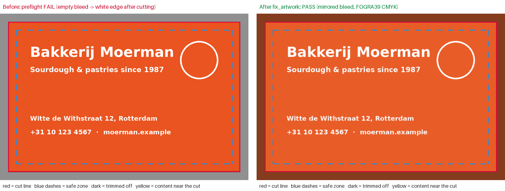

# printagent: order print from inside an AI assistant

An MCP server that lets Claude, ChatGPT, Cursor or any MCP client do what a
customer does on a print webshop: **find a product → get a price → check the
artwork → fix it → approve a proof → place a draft order**. All of it happens
in one conversation.

> "I need 500 business cards for my bakery, here's my logo file."
> → the assistant picks the product, quotes €54.45, sees the file has no bleed, fixes it,
> shows a proof with the cut line, spots that "Rotterdam" is misspelled, and drafts the order.



Unofficial prototype built for my HelloPrint application. The catalog and prices are mock data.

## Why this problem

At an online print shop, artwork issues are a big, quiet cost. Missing bleed,
low-resolution logos, RGB colours, fonts that aren't embedded and text too close
to the cut all lead to the same chain: rejected files, support tickets, delays
and reprints. Most of these checks are mechanical, so code can do them. The
rest (typos, a wrong phone number) needs eyes, and an LLM can provide those.

So the design splits the work:

| Layer | Does | Why |
|---|---|---|
| **Deterministic checks** (`preflight.py`) | size, bleed, effective dpi, CMYK, transparency, embedded fonts, empty bleed, safe zone | Fast, cheap, reproducible, testable. No hallucinations on a 3 mm rule. |
| **Safe auto-fixes** (`fixer.py`) | mirror-extend bleed, fill empty bleed, flatten, convert to CMYK with a FOGRA39 ICC profile | Only fixes that don't change the design. **Never upscales** to fake resolution, and **never crops** a wrong-sized file. Those go back to a human. |
| **LLM judgement** (`render_proof`) | The assistant *sees* a proof image with cut line and safe zone and checks spelling, contact details and cropped logos | This is what rules can't do. `samples/09_typo_passes_checks.tif` passes every rule and is caught by the model. |
| **Order gate** (`store.py`) | A draft order requires a passing preflight, for *this* product, on an *unchanged* file (sha256) | Agents act fast. The gate means they can't act sloppily. |

## Same engine, three surfaces

1. **Web upload** (`printagent-web`): drop a file, get a traffic-light report, a proof with the cut line and a one-click fix. Anyone gets it in five seconds.
2. **Customer-service agent**: the same report answers "why was my file rejected?".
3. **AI assistants over MCP**: Claude or ChatGPT orders on the customer's behalf.

## Tools

| Tool | |
|---|---|
| `search_products` | natural-language product search with print specs |
| `get_quote` | price tiers, paper, finish, express, VAT, delivery date and a "next tier" upsell hint |
| `preflight_artwork` | PDF / PNG / JPG / TIFF check → status, plain-language customer message, `preflight_id` |
| `fix_artwork` | writes `<name>_print-ready.pdf` and re-runs preflight on it |
| `render_proof` | returns the proof **image** to the model |
| `create_draft_order` / `get_order` | gated draft order |

## Run it

**Windows:** double-click `install_windows.bat` (installs, runs tests and the demo, registers the server in Claude Desktop), then `start_web.bat` for the web checker.

```bash
pip install -e ".[dev]"
python samples/make_samples.py     # 9 test cards, each with a classic mistake
pytest -q                          # 18 tests
python demo.py samples/03_no_bleed.png   # full flow over real MCP stdio
printagent-web                     # web checker at http://127.0.0.1:8765
```

**Claude Desktop** (`claude_desktop_config.json`):

```json
{ "mcpServers": { "printagent": { "command": "printagent" } } }
```

(or run `python scripts/setup_claude_desktop.py` inside the venv to add it automatically.)

Then ask: *"Order 500 business cards with this file: ~/Desktop/card.png"*.

For accurate colour, point `PRINTAGENT_CMYK_ICC` at a press profile (e.g. Coated FOGRA39).
Without one, the server falls back to a generic conversion and says so.

## Test set

| File | Result |
|---|---|
| `01_good_card.tif`, `02_good_card.pdf` | pass |
| `03_no_bleed.png` | fail → auto-fixed → pass |
| `04_empty_bleed.png` | fail → auto-fixed → pass |
| `05_text_near_cut.png` | warning, with the side highlighted on the proof |
| `06_low_res.jpg` | fail, **not** "fixed" by upscaling |
| `07_wrong_size.png` | fail, refuses to crop |
| `08_font_not_embedded.pdf` | fail → rasterised at 300 dpi → pass (flagged in changes) |
| `09_typo_passes_checks.tif` | passes all rules; only the LLM proof review catches "Rotterdma" |

## What I'd do next with real access

1. **Plug in the real catalog and pricing API** instead of `catalog.py` (the tools don't change).
2. **Measure it**: run preflight over a sample of historical uploads and compare with
   files that ended up in support tickets or reprints. That gives precision and recall per check,
   plus the euros saved.
3. **Use the same engine in three places**: the upload step on the website (instant
   feedback), the customer-service agent (answers "why was my file rejected?"), and
   the MCP server for agentic commerce.
4. Vector-preserving PDF fixes (add bleed without rasterising), spot colours, and
   checks for minimum line weight and text size.
5. Checkout handoff: draft order → payment link, so the assistant never touches card data.

## Known limitations

- Safe-zone detection uses edge density, so a busy photo running off the edge can trigger a
  (harmless) warning. A small vision model or text detection would make it sharper.
- Only page 1 is visually checked; fonts and page count are checked on pages 1–2.
- Without a press ICC profile (`PRINTAGENT_CMYK_ICC`), CMYK conversion uses a generic formula and colours shift more.
- Mock catalog and prices.
